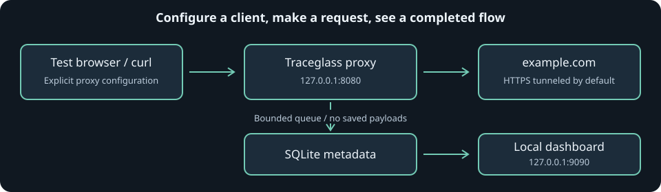

# First run: see your first network flows

This walkthrough uses the **primary Go implementation** on macOS/Linux.
You do not need administrator privileges, browser certificate changes, or a
system-wide proxy to try it. Inspect only traffic you own or are authorized to inspect.



## 1. Build and start

Install [Go 1.24 or newer](https://go.dev/doc/install), then:

```sh
git clone https://github.com/michaelnwanna/network-anomaly-packet-inspection.git
cd network-anomaly-packet-inspection
go mod download
go build -trimpath -o bin/traceglass ./cmd/traceglass
./bin/traceglass serve
```

Keep this terminal open. Startup prints:

```text
Proxy: http://127.0.0.1:8080
Dashboard: http://127.0.0.1:9090/#token=<your-session-token>
HTTPS inspection scope: []
Data: ./data
```

The token above is a placeholder, not a usable link. Open the **actual full
Dashboard URL from your terminal**. Treat it as a password; do not paste it into
issues, commits, or screenshots.

The browser removes the fragment after saving the token in that tab's session
storage. Seeing just `http://127.0.0.1:9090/` afterward is normal. A new tab may
need the full startup link again.

## 2. Generate two real requests

In a second terminal:

```sh
# Plain HTTP: the proxy can see the exchange metadata.
curl --noproxy "" --proxy http://127.0.0.1:8080 http://example.com/

# HTTPS: the proxy relays an encrypted tunnel. No local CA is needed.
curl --noproxy "" --proxy http://127.0.0.1:8080 https://example.com/
```

These contact the public example.com site; Internet access is needed.
`--noproxy ""` prevents an existing `NO_PROXY` setting from bypassing this demo.
The proxy is configured only for these commands, not for your whole device.

## 3. Read the dashboard

Within a few seconds, look for:

| Display | Meaning |
| --- | --- |
| Local connection healthy | This tab authenticated to the local API successfully |
| Retained flows | Committed, completed exchanges/tunnels still inside retention |
| Flagged signals | Retained flows matching at least one rule; not proof of malicious traffic |
| Transfer volume | Sum of retained upload/download counters |
| Active exchanges | Work still in progress; an active tunnel is not yet a completed row |
| Queued / dropped | Metadata waiting for storage / lost because storage could not accept it |

In **Outbound activity**, expect a `GET` row with **HTTP metadata** on port 80
and a `CONNECT` row with **Encrypted tunnel** on port 443. Successful example
requests normally show `200`; tunnel status describes CONNECT, not the encrypted
website's HTTP response. Sizes and timing vary.

- **Filter destination:** enter `example.com` and select **Apply filter**.
  This is a hostname substring search, not a URL/path search.
- **Flagged only:** restricts the table to rows with rule matches. Neither example
  request is guaranteed to trigger a rule.
- **Pause updates / Resume updates:** controls live polling. The visible,
  unpaused tab normally refreshes every three seconds.
- **Older activity:** loads a historical page and pauses live updates.
  Use **Back to latest** to return to live activity.

Counts cover retained history, not just the rows visible on the current page.
Long-lived tunnels appear only after they close. No bodies, headers, credentials,
paths, or query strings are saved.

## Use a browser

**Opening the dashboard does not configure browser traffic to use the proxy.**
Choose one of the setups below. Start with HTTPS passthrough: leave `-inspect`
unset and do not import any certificates.

### Firefox: dedicated test profile

1. Open `about:profiles`, create a profile named `Traceglass test`, and launch it
   in a new browser. A separate profile keeps testing settings out of daily browsing.
2. In that profile, open **Settings > General > Network Settings > Settings**.
   Labels may vary slightly by Firefox version.
3. Choose **Manual proxy configuration**.
4. Set **HTTP Proxy** to `127.0.0.1`, **Port** to `8080`.
5. Enable **Also use this proxy for HTTPS**. If separate HTTPS fields are shown,
   set their host/port to `127.0.0.1` / `8080` as well. Leave SOCKS unset.
6. Include `localhost, 127.0.0.1, ::1` in **No proxy for** so the dashboard stays
   direct. Save the settings.
7. Open `http://example.com` and `https://example.com`. Close those site tabs
   when done so their persistent connections can finish and appear in history.
8. In the dashboard, filter by `example.com`.

Browser HTTPS-only mode can upgrade the HTTP visit to HTTPS. That is fine:
you may see tunnels instead of a plain HTTP row. Use the curl example for a
predictable plain HTTP request.

### Chrome / Chromium: isolated process and profile

Chrome generally delegates its proxy UI to the operating system. For a scoped
demo, prefer launch flags with a **new, dedicated profile**, rather than changing
the system proxy. A separate profile directory ensures an already running daily
browser does not simply absorb the launch and ignore the flags.

On macOS with Google Chrome installed:

```sh
"/Applications/Google Chrome.app/Contents/MacOS/Google Chrome" \
  --user-data-dir="$HOME/.traceglass-chrome-demo" \
  --proxy-server="http://127.0.0.1:8080" \
  --proxy-bypass-list="localhost;127.0.0.1;[::1]" \
  "https://example.com/"
```

On Linux with Chromium installed:

```sh
chromium \
  --user-data-dir="$HOME/.traceglass-chromium-demo" \
  --proxy-server="http://127.0.0.1:8080" \
  --proxy-bypass-list="localhost;127.0.0.1;[::1]" \
  "https://example.com/"
```

Your executable may be named `chromium-browser` or `google-chrome`; use the
installed executable. Managed browser policies can override proxy settings.
These profiles can contain browsing state: do not sign into personal accounts
for a demo. Do not use `--ignore-certificate-errors`.

Safari uses system network proxy settings; it is not recommended for this
isolated first-run workflow.

## Optional: inspect an HTTPS exchange

The two-request demo above works without decryption. Enable MITM only when you
need to inspect an explicitly authorized host.

Stop Traceglass with `Ctrl-C`, then use a **new, dedicated inspection directory**:

```sh
./bin/traceglass ca init -data-dir ./data-inspection-demo
./bin/traceglass serve -data-dir ./data-inspection-demo -inspect example.com
```

Open the newly printed dashboard link. In another terminal:

```sh
curl --noproxy "" \
  --proxy http://127.0.0.1:8080 \
  --cacert ./data-inspection-demo/traceglass-ca.crt \
  https://example.com/
```

Expect **HTTPS inspected** rather than **Encrypted tunnel**. Scope is exact:
`example.com` does not include `www.example.com`; `*.example.com` includes
subdomains but not the apex.

This curl command trusts the CA only for that invocation; it does not install
system/browser trust. The server still verifies the real upstream certificate.
Never use `curl -k` as a workaround.

For browser MITM, import **only the public** `traceglass-ca.crt` through the
dedicated test browser's certificate manager, with website/authority trust if
offered. Certificate UI and trust scope vary by browser/platform; some use OS
trust even with a separate browser profile. If isolated trust is not available,
stay with curl rather than installing a debugging CA system-wide. Never import
or share `traceglass-ca.key`. Remove any trust you added after the test.

Read [the threat model](THREAT-MODEL.md) before enabling inspection.

## Stop and clean up

1. Close test-site tabs/windows. Restore Firefox's previous proxy setting (or
   choose **No proxy** in a disposable test profile).
2. If you set shell proxy variables, clear them in that shell:

   ```sh
   unset HTTP_PROXY HTTPS_PROXY http_proxy https_proxy NO_PROXY no_proxy
   ```

   If those variables existed before testing, restore their previous values instead.
3. Remove any inspection CA trust you deliberately imported.
4. Press `Ctrl-C` in the Traceglass terminal; allow it to drain accepted metadata.
5. Keep the dedicated state directory private. It contains browsing metadata
   and, if initialized, a powerful signing key. Do not commit or upload it.

Stopping the proxy does not delete retained history or undo manually configured
browser settings. Browser profiles and state directories can be removed manually
when no longer needed, after closing the corresponding applications.

## Other implementations and next steps

- [C# instructions](../implementations/csharp/README.md)
- [C++ instructions](../implementations/cpp/README.md)
- [Rust instructions](../implementations/rust/README.md)
- [Compatibility and isolated state](IMPLEMENTATIONS.md)
- [Rules, retention, and resource controls](../README.md#operational-controls)
- [Troubleshooting](TROUBLESHOOTING.md)
- [Read-only API](API.md)
